# Hướng dẫn sử dụng — IELTS Vocab Companion

**Vai trò tài liệu:** IT Business Analyst  
**Đối tượng đọc:** Trainer, end-user, stakeholder kỹ thuật  
**Phiên bản app:** 1.0 (portable Windows)  
**File chạy:** `IELTS Vocab.exe` (Desktop)  
**Dữ liệu local:** `%APPDATA%\IELTS Vocab\`

---

## 1. Mục đích sản phẩm

Ứng dụng desktop chạy local giúp người học:

1. Học từ/cụm IELTS (band ~6.5) bằng **spaced repetition (SRS)**  
2. Nhắc ôn bằng **popup góc màn hình** (không cướp focus)  
3. Luyện **Writing** qua cụm & khung câu  
4. Thực hành **REST API** (kiểu banking) qua **API Lab / Swagger** — vừa học từ vừa học API  

App **không** tự khởi động cùng Windows; user chủ động mở `.exe`.

---

## 2. Actors & phạm vi

| Actor | Mô tả |
|-------|--------|
| **Learner** | Người học IELTS / tự học API |
| **Trainer** | Người hướng dẫn, demo workflow |
| **System** | Electron main + SQLite + scheduler + API server local |

**Trong phạm vi (In scope)**

- Học thẻ, popup nhắc, Writing Lab, Browse, Settings, API Lab  

**Ngoài phạm vi (Out of scope)**

- Chấm essay bằng AI, đồng bộ cloud, OAuth banking thật  

---

## 3. Bản đồ chức năng (Capability map)

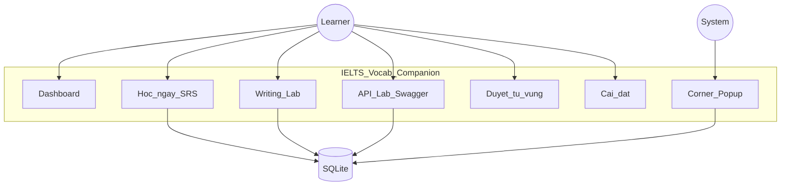

---

## 4. Cài đặt & khởi chạy

### 4.1 Preconditions

- Windows 10/11  
- File `IELTS Vocab.exe` trên Desktop (portable, không cần cài)  

### 4.2 Workflow khởi chạy (BPMN 2.0 — style)

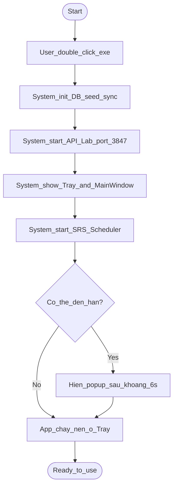

### 4.3 Hướng dẫn từng bước

1. Double-click `IELTS Vocab.exe`  
2. Cửa sổ chính mở; icon xuất hiện ở **system tray**  
3. Đóng cửa sổ = **ẩn xuống tray** (app vẫn nhắc ôn)  
4. Thoát hẳn: chuột phải tray → **Thoát**  

---

## 5. Use case tổng quan

| ID | Use case | Actor | Mức ưu tiên |
|----|----------|-------|-------------|
| UC-01 | Xem Dashboard & tiến độ | Learner | Must |
| UC-02 | Học phiên (flip / quiz / type) | Learner | Must |
| UC-03 | Ôn qua popup góc màn hình | Learner + System | Must |
| UC-04 | Writing Lab (cụm / khung câu / paraphrase) | Learner | Should |
| UC-05 | Duyệt / thêm / sửa thẻ | Learner | Should |
| UC-06 | Cấu hình SRS & quiet hours | Learner | Must |
| UC-07 | API Lab — POST enrich từ vựng | Learner / Trainer | Should |
| UC-08 | Swagger Try-it-out | Trainer | Should |

---

## 6. UC-02 — Học phiên (SRS)

### 6.1 Mô tả nghiệp vụ

Learner chủ động ôn các thẻ đến hạn. Mỗi thẻ chấm điểm **1 Quên / 2 Khó / 3 Nhớ / 4 Dễ**. Hệ thống tính lại lịch ôn (SM-2).

### 6.2 Sequence diagram

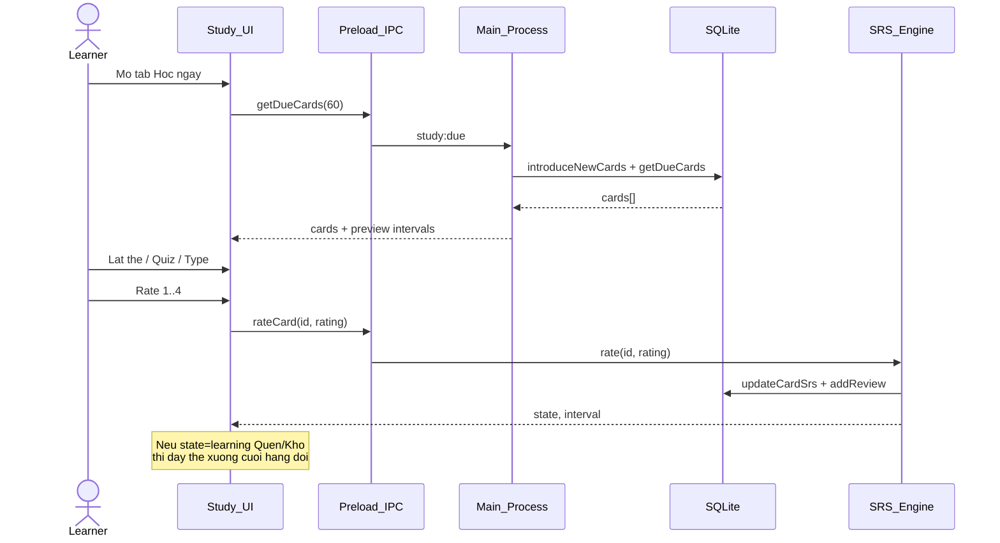

### 6.3 BPMN — luồng đánh giá thẻ

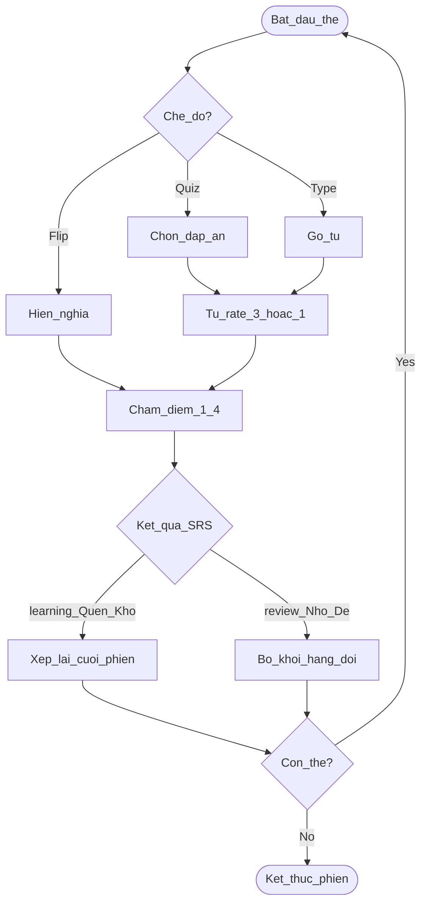

### 6.4 Quy tắc nghiệp vụ (Business rules)

| BR | Nội dung |
|----|----------|
| BR-01 | Thẻ mới / đang học + **Khó** → giữ `learning`, hiện lại ~30 phút, ở lại phiên |
| BR-02 | **Quên** → `learning`, ~10 phút, ở lại phiên |
| BR-03 | **Nhớ / Dễ** → tốt nghiệp `review`, giãn ngày |
| BR-04 | Hết thẻ → có thể **Học thêm 10 từ mới** (bỏ giới hạn ngày) |

### 6.5 Happy path (script trainer)

1. Sidebar → **Học ngay**  
2. Chọn **Lật thẻ**  
3. Space / “Hiện nghĩa” → chọn **Nhớ**  
4. Lặp đến hết hàng đợi  

---

## 7. UC-03 — Popup nhắc ôn

### 7.1 Sequence

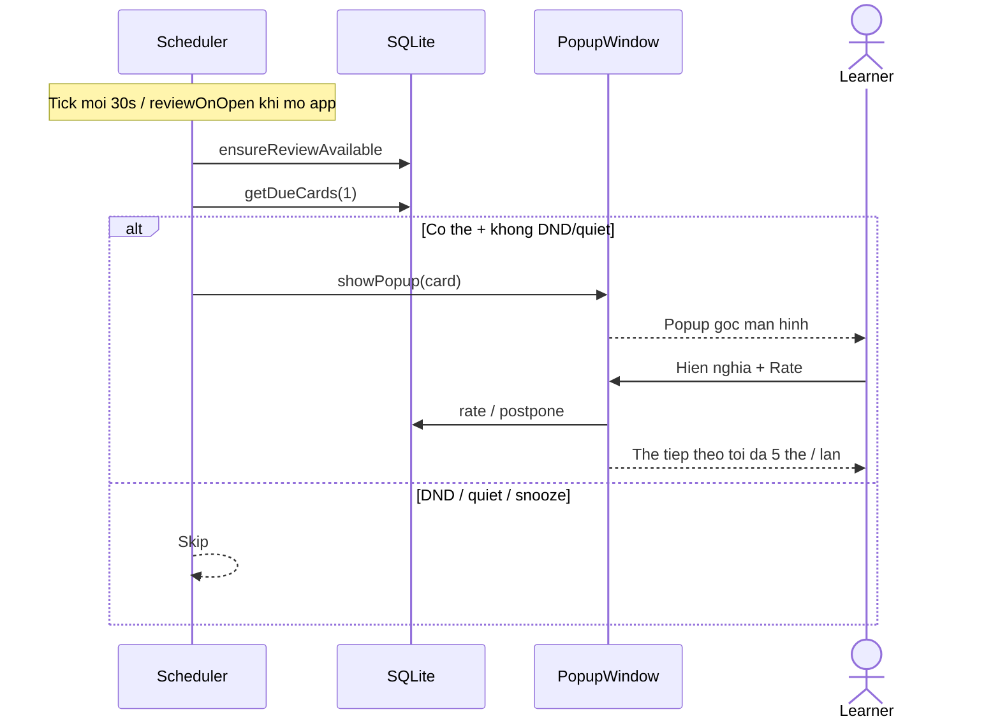

### 7.2 BPMN — quyết định có hiện popup không

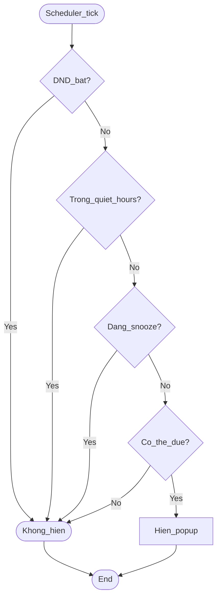

### 7.3 Hướng dẫn user

- Không tương tác → popup tự ẩn (~20s), thẻ dời ~15 phút  
- **Snooze** → tạm dừng nhắc theo phút trong Settings  
- Tray → bật/tắt **Do Not Disturb** khi đang họp  

---

## 8. UC-04 — Writing Lab

### 8.1 Ba chế độ

| Mode | Mục tiêu học | Đầu ra |
|------|--------------|--------|
| Cụm theo chức năng | Flashcard SRS theo opinion/cause/contrast/solution/conclusion/task1 | Cập nhật SRS |
| Điền khung câu | Chọn đúng cụm vào `_____` | Feedback đúng/sai |
| Paraphrase | Viết lại câu có chứa cụm mục tiêu/đồng nghĩa | Check chuỗi đơn giản |

### 8.2 BPMN — Writing session

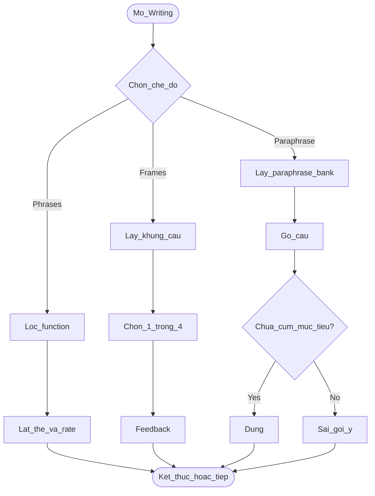

### 8.3 Script demo trainer

1. **Writing** → **Cụm theo chức năng** → lọc **Nguyên nhân – Kết quả**  
2. Quay lại hub → **Điền khung câu** → làm 3 câu  
3. **Paraphrase** → dùng gợi ý chip → Kiểm tra  

---

## 9. UC-05 — Duyệt từ vựng

### 9.1 Năng lực

- Lọc theo chủ đề (gồm Writing Task 1, cụm Writing…)  
- Tìm kiếm EN/VN  
- Thêm / sửa / xóa thẻ custom  
- Đánh dấu sao (từ khó)  

### 9.2 Sequence — thêm thẻ thủ công

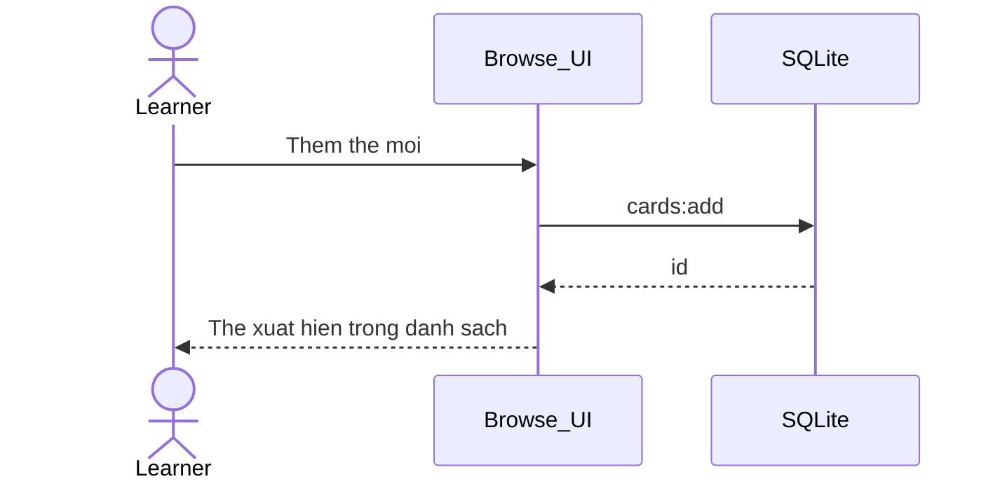

---

## 10. UC-06 — Cài đặt

| Tham số | Ý nghĩa nghiệp vụ | Gợi ý mặc định |
|---------|-------------------|----------------|
| Từ mới / ngày | Pace lộ trình ~6 tháng | 10 |
| Khoảng cách popup | Tần suất nhắc khi làm việc | 25 phút |
| Auto-hide popup | Thời gian tự ẩn | 20 giây |
| Snooze | Tạm nghỉ nhắc | 30 phút |
| Quiet hours | Không nhắc (vd 22:00–08:00) | Có |
| DND | Tắt hết popup | Tắt khi học |
| Ngày thi | Đếm ngược Dashboard | User nhập |

---

## 11. UC-07 / UC-08 — API Lab (học API + từ vựng)

### 11.1 Giá trị nghiệp vụ

Learner/Trainer thực hành REST như **banking onboarding**:

- `POST` tạo resource (từ) → server **enrich** (POS, IPA, VN, CEFR, example, ảnh)  
- `409` khi trùng → hiểu conflict / idempotency  
- Swagger UI = tài liệu sống để demo stakeholder  

**Base URL mặc định:** `http://127.0.0.1:3847`  
**Swagger:** `http://127.0.0.1:3847/docs`

### 11.2 Sequence — POST enrich

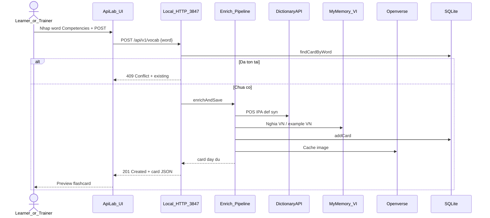

### 11.3 BPMN — luồng tạo từ qua API

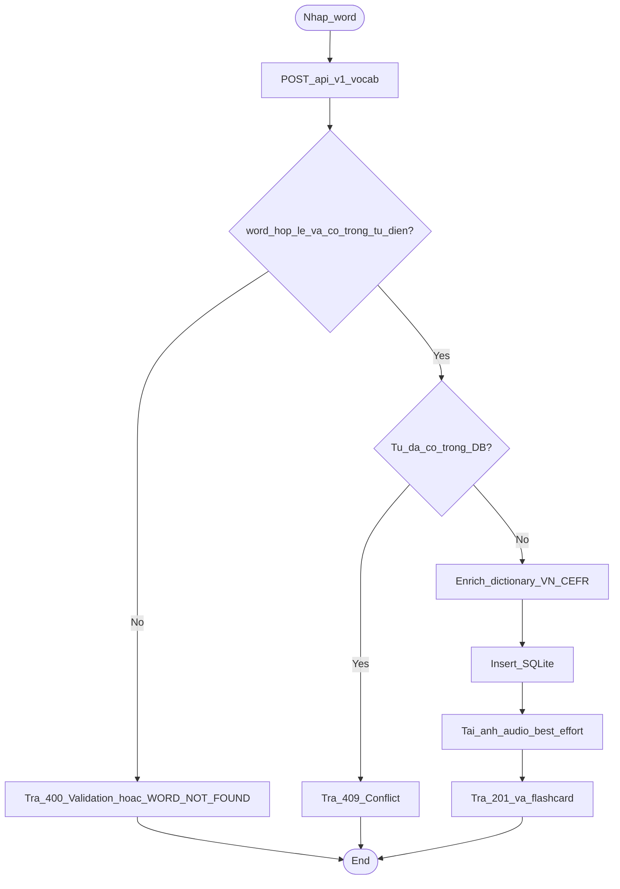

### 11.4 Bảng endpoint (cho trainer)

| Method | Path | Banking analogy | Status điển hình |
|--------|------|-----------------|------------------|
| GET | `/health` | Ping gateway | 200 |
| GET | `/docs` | Portal tài liệu API | 200 |
| POST | `/api/v1/vocab` | Mở hồ sơ + enrich KYC | 201 / 400 / 409 |
| GET | `/api/v1/vocab?q=` | Tra cứu danh sách | 200 |
| GET | `/api/v1/vocab/{id}` | Chi tiết account | 200 / 404 |
| PATCH | `/api/v1/vocab/{id}` | Cập nhật KYC một phần | 200 / 404 |
| DELETE | `/api/v1/vocab/{id}` | Đóng / xóa resource | 204 / 404 |
| POST | `/api/v1/vocab/{id}/review` | Ghi transaction/sự kiện | 200 / 400 |

### 11.5 Script demo 5 phút (Trainer)

1. Mở app → **API Lab** → xác nhận **● Running**  
2. POST `Competencies` → xem **201** + preview VN/CEFR  
3. POST lại → **409** → giải thích conflict  
4. Bấm **Mở Swagger UI** → Try it out `GET /api/v1/vocab`  
5. Sidebar → **Duyệt từ vựng** → tìm `Competencies` (đã vào kho)  

**Request mẫu**

```json
POST http://127.0.0.1:3847/api/v1/vocab
Content-Type: application/json

{ "word": "Competencies" }
```

### 11.6 Hướng dẫn sử dụng Swagger UI (chi tiết cho Trainer / Learner)

Swagger UI là giao diện tài liệu API sống (kiểu **Swagger Petstore**): nền sáng, HTTP method tô màu (GET xanh dương, POST xanh lá, DELETE đỏ), nhóm theo tag, và **Try it out**.

#### 11.6.1 Preconditions

| Điều kiện | Chi tiết |
|-----------|----------|
| App đang chạy | `IELTS Vocab.exe` đã mở (API Lab bind `127.0.0.1`) |
| Trạng thái API | Tab **API Lab** hiện **● Running** |
| Mạng | Cần internet lần đầu để tải CSS/JS Swagger từ CDN (`unpkg`) |
| Trình duyệt | Edge / Chrome khuyến nghị |

#### 11.6.2 Cách mở Swagger

**Cách A — từ trong app (khuyến nghị)**

1. Sidebar → **API Lab**  
2. Bấm **Mở Swagger UI**  
3. Trình duyệt mở: `http://127.0.0.1:3847/docs`  

**Cách B — gõ URL thủ công**

- Swagger UI: `http://127.0.0.1:3847/docs` (alias `/swagger`)  
- OpenAPI JSON: `http://127.0.0.1:3847/openapi.json`  

> Nếu port `3847` bị chiếm, app tự tăng port (`3848`…). Luôn lấy URL đúng từ dòng **Local API** trên tab API Lab.

#### 11.6.3 Làm quen giao diện Swagger

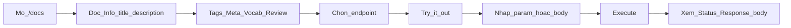

| Vùng trên màn hình | Ý nghĩa |
|--------------------|---------|
| **Title / Description** | Tên API Lab + mô tả banking analogy |
| **Servers** | Base URL local (vd `http://127.0.0.1:3847`) |
| **Tag Meta** | Health, docs |
| **Tag Vocab** | CRUD + enrich từ vựng |
| **Tag Review** | SRS rate |
| Nút **Try it out** | Bật form nhập để gọi API |
| Nút **Execute** | Gửi request thật |
| **Responses** | Status code + JSON trả về |

#### 11.6.4 BPMN — thao tác Try it out chuẩn

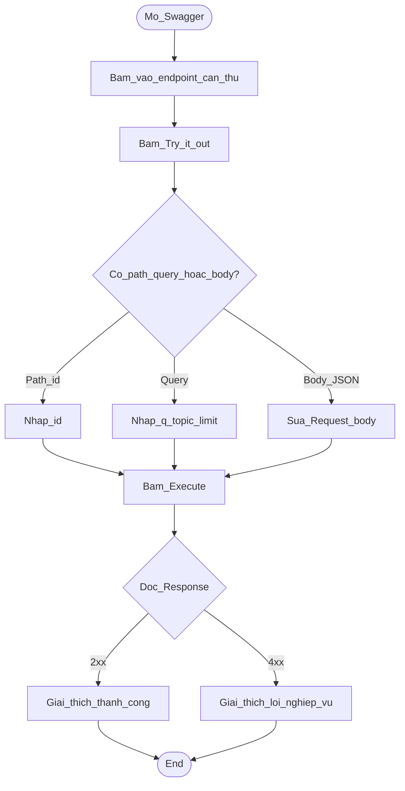

#### 11.6.5 Bài thực hành từng endpoint trên Swagger

**Bài 1 — Health check (làm quen Execute)**

1. Mở tag **Meta** → `GET /health`  
2. **Try it out** → **Execute**  
3. Kỳ vọng: **200**, `"status": "ok"`  
4. Ý nghĩa: giống ping gateway banking trước khi gọi API nghiệp vụ  

**Bài 2 — POST tạo từ + enrich (use case chính)**

1. Tag **Vocab** → `POST /api/v1/vocab`  
2. **Try it out**  
3. Trong **Request body**, giữ hoặc sửa:

```json
{
  "word": "Competencies"
}
```

4. (Tuỳ chọn) thêm `"topic": "work_business"`, `"vn": "..."`, `"cefr": "B2"`  
5. **Execute**  
6. Kỳ vọng lần đầu: **201 Created** — body có `card` với `pos`, `ipa`, `vn`, `def`, `example`, `cefr`, `topic`…  
7. Giải thích cho học viên: chỉ gửi `word` → server **validate từ điển** rồi **enrich** như onboarding/KYC  
8. Thử sai chính tả `inspirez` → kỳ vọng **400** `WORD_NOT_FOUND` (không tạo thẻ) — giống reject dữ liệu KYC không hợp lệ  

**Bài 3 — Conflict 409 (idempotency)**

1. Lặp lại đúng **Bài 2** với cùng `word`  
2. Kỳ vọng: **409** — `error: CONFLICT`, có thể kèm `existing`  
3. Giải thích: không tạo trùng resource (giống hồ sơ đã tồn tại)  

**Bài 4 — GET list / search**

1. `GET /api/v1/vocab` → **Try it out**  
2. `q` = `Competencies` (hoặc để trống), `limit` = `5`  
3. **Execute** → **200**, mảng `items`  
4. Banking analogy: lọc danh sách giao dịch / tài khoản  

**Bài 5 — GET by id**

1. Từ response Bài 2 hoặc 4, copy `card.id` (vd `912`)  
2. `GET /api/v1/vocab/{id}` → **Try it out** → nhập `id`  
3. **Execute** → **200** chi tiết thẻ; sai id → **404**  

**Bài 6 — PATCH cập nhật một phần**

1. `PATCH /api/v1/vocab/{id}` → nhập `id`  
2. Body ví dụ:

```json
{
  "vn": "năng lực chuyên môn (banking)"
}
```

3. **Execute** → **200**, field `vn` đổi — giống cập nhật KYC từng phần  

**Bài 7 — POST review (SRS)**

1. `POST /api/v1/vocab/{id}/review`  
2. Body:

```json
{
  "rating": 3
}
```

3. `rating`: `1` Quên · `2` Khó · `3` Nhớ · `4` Dễ  
4. **Execute** → **200**; rating ngoài 1–4 → **400**  
5. Analogy: ghi một “giao dịch / sự kiện” lên resource  

**Bài 8 — DELETE (cẩn thận khi demo)**

1. Chỉ xóa thẻ **test** vừa tạo  
2. `DELETE /api/v1/vocab/{id}` → **Execute**  
3. Kỳ vọng: **204** (thường không có body)  
4. Gọi lại GET id → **404**  

#### 11.6.6 Sequence — Trainer hướng dẫn Swagger trên lớp

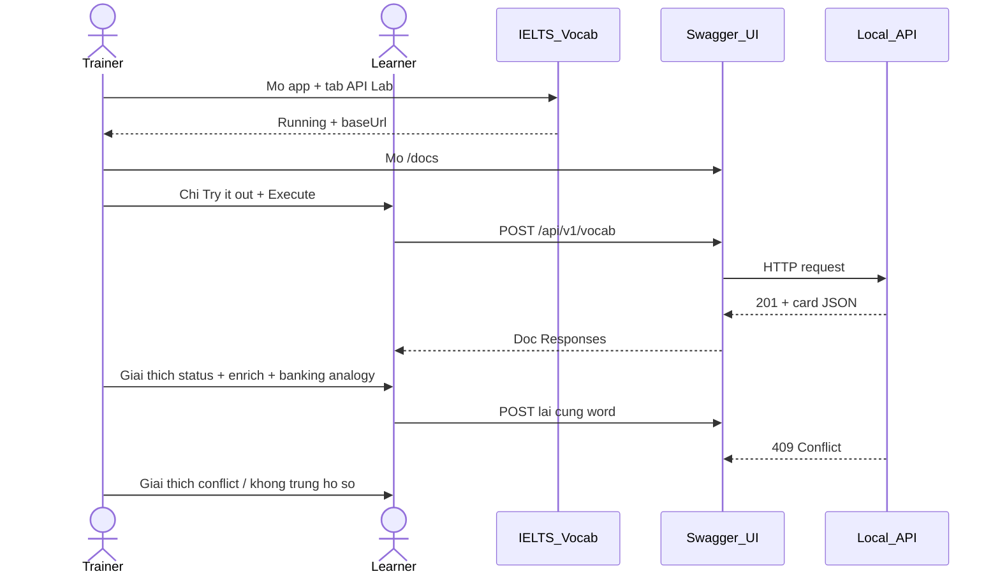

#### 11.6.7 Đọc Response đúng cách (checklist trainer)

Sau mỗi **Execute**, yêu cầu học viên nêu:

1. **HTTP status** (201 / 400 / 404 / 409…) nghĩa nghiệp vụ là gì?  
2. **Request** đã gửi (path, query, body)  
3. **Field quan trọng trong JSON** (`card.word`, `card.vn`, `card.cefr`…)  
4. **Banking analogy** tương ứng (ghi trên mô tả endpoint hoặc tab API Lab)  

#### 11.6.8 Lỗi thường gặp khi dùng Swagger

| Hiện tượng | Nguyên nhân | Cách xử lý |
|------------|-------------|------------|
| Trang `/docs` trắng / không load UI | Không có mạng (CDN Swagger) | Bật mạng; hoặc dùng tab **API Lab** Try-it trong app |
| Failed to fetch / Connection refused | App chưa chạy hoặc sai port | Mở lại exe; copy đúng URL từ API Lab |
| Execute mãi pending | Enrich đang gọi dictionary/dịch | Đợi 5–20s; cần mạng |
| 400 VALIDATION_ERROR | Thiếu `word` hoặc JSON sai | Sửa Request body |
| 400 WORD_NOT_FOUND | Sai chính tả / không có trong từ điển (vd `inspirez`) | Sửa spelling (vd `inspire`) rồi POST lại |
| 409 CONFLICT | Từ đã có trong DB | Đổi từ khác hoặc GET id hiện có |
| 404 NOT_FOUND | Sai `id` | Copy lại id từ POST/GET list |
| Server dropdown sai URL | Đổi port sau khi restart | F5 trang `/docs`; kiểm tra `openapi.json` |

#### 11.6.9 Script demo Swagger thuần (10 phút)

| Phút | Việc | Kỳ vọng |
|------|------|---------|
| 0–1 | Mở app + Swagger `/docs` | UI hiện đủ tag |
| 1–2 | `GET /health` | 200 |
| 2–5 | `POST /vocab` từ mới (vd `Liquidity`) | 201 + enrich |
| 5–6 | POST trùng | 409 |
| 6–8 | `GET /vocab?q=Liquidity` | Thấy item |
| 8–9 | `PATCH` sửa `vn` | 200 |
| 9–10 | `POST .../review` rating 3 | 200; Q&A status code |

---

## 12. Kiến trúc logic (cho stakeholder kỹ thuật)

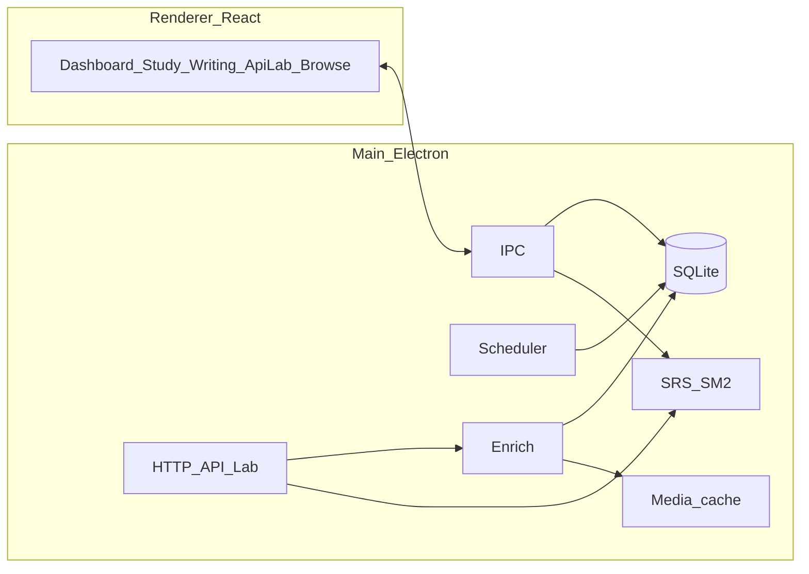

---

## 13. Dữ liệu & vận hành

| Hạng mục | Vị trí / ghi chú |
|----------|------------------|
| Database | `%APPDATA%\IELTS Vocab\vocab.db` |
| Cache ảnh/audio | `%APPDATA%\IELTS Vocab\images`, `audio` |
| Seed từ vựng | Đóng gói trong app; `syncNewSeeds` khi mở bản mới |
| API port | `3847` (tự +1 nếu bị chiếm) |

**Lưu ý vận hành**

- Chỉ bind `127.0.0.1` — không expose ra mạng LAN  
- Swagger UI tải asset từ CDN (cần mạng lần đầu mở `/docs`)  
- Enrich cần mạng (dictionary / dịch / ảnh)  

---

## 14. Xử lý sự cố (FAQ trainer)

| Triệu chứng | Nguyên nhân gợi ý | Cách xử lý |
|-------------|-------------------|------------|
| Không thấy popup | DND / quiet hours / hết due | Settings; Học thêm từ; mở lại app |
| API Lab “Starting…” mãi | Port lỗi / app chưa ready | Đợi vài giây; mở lại exe |
| POST lỗi mạng | App chưa chạy API | Mở app trước khi gọi API |
| POST 409 | Từ đã có | GET search hoặc dùng từ khác |
| Nghĩa Việt generic | Ngoài glossary banking | PATCH sửa `vn` hoặc sửa ở Browse |
| Mất tiến độ | Xóa folder AppData | Không xóa `%APPDATA%\IELTS Vocab` |
| Swagger trắng / không CSS | CDN `unpkg` bị chặn / offline | Bật mạng; tạm dùng Try-it trong tab API Lab |
| Swagger Failed to fetch | App tắt hoặc sai port | Mở app; kiểm tra URL trên API Lab |
| Execute chậm | Pipeline enrich đang gọi mạng | Đợi; kiểm tra kết nối internet |

---

## 15. Kịch bản đào tạo đề xuất (1 buổi ~45 phút)

| Phút | Nội dung | UC |
|------|----------|-----|
| 0–5 | Cài đặt, tray, Settings ngày thi | UC-06 |
| 5–15 | Học ngay + giải thích Quên/Khó/Nhớ/Dễ | UC-02 |
| 15–20 | Để popup hiện, snooze, DND | UC-03 |
| 20–30 | Writing Lab 3 chế độ | UC-04 |
| 30–40 | API Lab POST + 409 + **Swagger Try it out** (mục 11.6) | UC-07/08 |
| 40–45 | Browse tìm từ vừa POST; Q&A | UC-05 |

---

## 16. Thuật ngữ

| Thuật ngữ | Định nghĩa ngắn |
|-----------|-----------------|
| **SRS** | Spaced Repetition — ôn đúng lúc sắp quên |
| **Due** | Thẻ đến hạn ôn |
| **Enrich** | Server tự bổ sung thuộc tính từ input tối thiểu |
| **Quiet hours** | Khung giờ không nhắc |
| **DND** | Do Not Disturb — tắt popup |
| **Flashcard** | Thẻ từ: mặt trước (từ) / mặt sau (nghĩa + ví dụ) |

---

## 17. Lịch sử tài liệu

| Ngày | Phiên bản | Thay đổi |
|------|-----------|----------|
| 2026-08-16 | 1.0 | HDSD đầy đủ: Vocab, Writing, Popup, API Lab + BPMN/Sequence |
| 2026-08-16 | 1.1 | Bổ sung mục **11.6 Hướng dẫn sử dụng Swagger UI** (Try it out, bài thực hành, FAQ) |

---

*Tài liệu do IT BA soạn cho mục đích onboarding & training. Có thể export Mermaid sang PNG/SVG qua [mermaid.live](https://mermaid.live) khi trình bày slide.*
