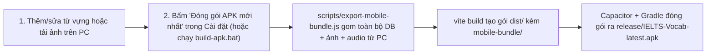

# Kế hoạch & Hướng dẫn: Đóng gói Android APK + Kho Ảnh Offline 100%

Tài liệu này giải đáp chi tiết câu hỏi số 2 của bạn và hướng dẫn cách sử dụng hệ thống đóng gói **Android APK** + **Ảnh Offline** đã được tích hợp sẵn vào dự án.

---

## 1. Hình ảnh và âm thanh đang được lưu từ đâu? Có ảnh hưởng việc dùng Offline không?

### 1.1 Cơ chế lưu trữ hiện tại
- **Nguồn ảnh minh họa:** Tự động tìm và tải từ **Openverse API** (`https://api.openverse.org/v1/images/` — kho ảnh Creative Commons miễn phí, không cần API key).
- **Nguồn âm thanh phát âm:** Tự động tải file `.mp3` giọng chuẩn từ **dictionaryapi.dev** (`https://api.dictionaryapi.dev`), và nếu từ dài/cụm từ không có file mp3 thì dùng bộ đọc giọng nói có sẵn của hệ điều hành (`speechSynthesis` trên Windows / Android).
- **Vị trí lưu trên máy tính (Local Cache):**
  - Toàn bộ ảnh đã tải nằm tại: `%APPDATA%\IELTS Vocab\images\<id_thẻ>.jpg`
  - Toàn bộ audio đã tải nằm tại: `%APPDATA%\IELTS Vocab\audio\<id_thẻ>.mp3`
  - Cơ sở dữ liệu từ vựng nằm tại: `%APPDATA%\IELTS Vocab\vocab.db`

### 1.2 Ảnh hưởng khi không có Internet & Giải pháp đã triển khai
1. **Đã sửa lỗi mất mạng (Offline retry fix):** Trước đây nếu bạn mở một thẻ mới khi không có mạng, hệ thống đánh dấu `image_tried = 1` vĩnh viễn khiến thẻ đó không bao giờ tải ảnh nữa. Hiện tại [`src/main/media.js`](file:///c:/Users/Dell/Documents/Vibe/src/main/media.js) đã được sửa: nếu mất mạng sẽ tự động thử lại ở lần có mạng tiếp theo.
2. **Nút "⬇️ Tải toàn bộ ảnh & audio về máy (Offline)" trong mục Cài đặt:**
   - Bạn chỉ cần bật mạng 1 lần, vào **Cài đặt → Kho Ảnh & Audio Offline** và bấm nút tải toàn bộ.
   - Hệ thống chạy đa luồng tải hết ảnh minh họa + mp3 cho toàn bộ ~1.300+ thẻ từ vựng về ổ cứng (`%APPDATA%\IELTS Vocab\`).
   - Sau khi tải xong, cả ứng dụng PC lẫn file APK đóng gói ra đều **hoạt động 100% không cần Internet**, giữ nguyên hình ảnh sinh động.

---

## 2. Cơ chế đóng gói ứng dụng sang điện thoại Android (file `.APK`)

Vì ứng dụng gốc viết bằng **Electron + React (Vite)**, phần giao diện React đã được nâng cấp kèm lớp tương thích di động [`src/renderer/src/mobile-api.js`](file:///c:/Users/Dell/Documents/Vibe/src/renderer/src/mobile-api.js) và giao diện responsive cho màn hình dọc.

### 2.1 Quy trình "Cập nhật từ vựng trên PC → Bung file APK mới nhất"



Mỗi khi bạn bấm nút **"⚡ Đóng gói APK mới nhất (từ dữ liệu PC)"** trong tab **Cài đặt** (hoặc bấm đúp file [`build-apk.bat`](file:///c:/Users/Dell/Documents/Vibe/build-apk.bat)):
1. Script [`scripts/export-mobile-bundle.js`](file:///c:/Users/Dell/Documents/Vibe/scripts/export-mobile-bundle.js) đọc trực tiếp資料庫 `%APPDATA%\IELTS Vocab\vocab.db` của bạn trên PC (bao gồm toàn bộ từ vựng IELTS A1→C2, các từ bạn tự thêm ở tab Duyệt từ vựng hoặc qua API Lab, cùng toàn bộ tiến độ học) và copy toàn bộ ảnh/audio trong `%APPDATA%\IELTS Vocab\images` & `audio` vào `src/renderer/public/mobile-bundle/`.
2. Đồng thời xuất file [`release/ielts-vocab-latest-backup.json`](file:///c:/Users/Dell/Documents/Vibe/release/ielts-vocab-latest-backup.json).
3. Khi bạn cài đè file APK mới lên điện thoại, ứng dụng trên điện thoại tự động **hợp nhất (merge)** các từ vựng và hình ảnh mới từ PC vào điện thoại mà **không làm mất tiến độ bạn đã ôn trên điện thoại**.

---

## 3. Hai cách lấy file `.APK` để cài lên điện thoại

### Cách 1: Đóng gói trực tiếp trên máy tính Windows của bạn (Offline Local Build)
Để máy tính tự xuất ra file `release\IELTS-Vocab-latest.apk` khi bấm nút trong Cài đặt, bạn chỉ cần cài đặt môi trường 1 lần duy nhất:
1. Cài **Node.js LTS** (https://nodejs.org) và **Android Studio** (hoặc Android Command Line Tools + JDK 21).
2. Mở PowerShell tại thư mục dự án `c:\Users\Dell\Documents\Vibe` và chạy 1 lần:
   ```powershell
   npm install --save-dev @capacitor/core @capacitor/cli @capacitor/android
   npx vite build
   npx cap add android
   ```
3. Từ lần thứ 2 trở đi: mỗi khi cập nhật từ vựng trên PC, bạn chỉ cần bấm nút **"⚡ Đóng gói APK mới nhất"** ngay trong Cài đặt của app (hoặc chạy `build-apk.bat`). File APK sẽ nằm sẵn ở `release\IELTS-Vocab-latest.apk`.

### Cách 2: Đóng gói tự động qua GitHub Actions (Không cần cài Android Studio trên máy)
Dự án đã có sẵn file cấu hình [`.github/workflows/build-apk.yml`](file:///c:/Users/Dell/Documents/Vibe/.github/workflows/build-apk.yml):
1. Sau khi bấm nút đóng gói trong Cài đặt (để cập nhật gói dữ liệu mới nhất), bạn push code lên GitHub.
2. Vào tab **Actions** trên GitHub → chọn workflow **Build Android APK (IELTS Vocab)** → tải file `IELTS-Vocab-latest.apk` về điện thoại và cài đặt.

### Cách 3: Cập nhật từ vựng tức thì không cần cài lại APK
Nếu điện thoại đã cài sẵn APK và bạn chỉ vừa thêm vài chục từ mới trên PC:
1. Trên PC: lấy file `release/ielts-vocab-latest-backup.json` (tự sinh ra mỗi khi bạn bấm nút Đóng gói trong Cài đặt) gửi qua Zalo/Drive sang điện thoại.
2. Trên điện thoại: vào **Cài đặt → 📥 Nạp file dữ liệu từ PC (.json)** là toàn bộ từ mới có mặt ngay lập tức!

